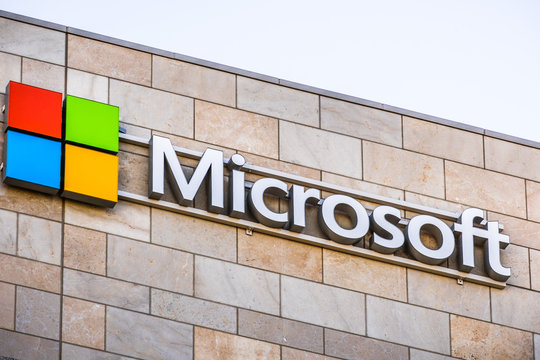

# Analyse du domaine — Khushi Thapa

## Découverte de soi

- Mes forces : organisée, curieuse, ouverture d’esprit
    - Exemple : J'aime savoir comment les choses que j'utilise dans tout les jours fonctionnent. Je suis organisée, j'ai un agenda dans laquelle je prend note des dates importantes. Je prends en compte plusieurs point de vue quand je me bati un opinion.
- Mes faiblesses ou points à améliorer : Procrastination, perfectionniste
    - Exemple : Je débute toujours mes travaux à la dernière minute et en meme temps, je veut que ça soit parfait, donc je passe beaucoup plus de temps que prevue à les faire, car je veut que toutes les petites trucs soit parfaits. 
- Seul(e) ou en équipe : seul
    - Pourquoi et exemple : Je n'ai pas de confiance que je peut confier le travail au d'autres personnes. J'ai déjà eu des problème dans le travail d'equipe ou les autres membres ne faisaient pas leurs travail.
- Plutôt technique ou créatif : Technique

## Exploration des domaines

| Domaine | Intérêt | Pourquoi |
|---|---|---|
| Graphisme | moyen | J'aime expérimenter les couleurs et la composition, mais je ne m'y intéresse pas trop en creation. |
| Vidéo et animation 2D | moyen | J'aime regarder des vidéos en 2d mais je ne suis pas sûre que je vais aimer en crée mais je suis intéressé à l'apprendre. |
| 3D | moyen | J'aime regarder des créations en 3d mais je ne suis pas sûre que je vais aimer en crée mais je suis intéressé à l'apprendre. |
| Web | fort | J'aime coder sur les sujets qui m'intéressent. |
| Jeux vidéo | moyen | Je m'intéresse pas trop au développement de jeux-vidéos mais je joue régulièrement des jeux d'une seule catégorie. |
| Développement logiciel | moyen | J'aime développer et coder et j'aime résoudre les problèmes que je rencontre pendant le processus. |
| Installations et expériences immersives | faible | Je n'ai pas d'expériences avec des installations et expériences immersives et ça ne m'intéresse pas trop. |

## Mes 2 domaines préférés

### Domaine 1 : web

- Expérience : J'ai fais un peu de HTML et CSS dans mon domaine d'étude. 
- Logiciels et outils : Visual Studio Code et GitHub
- Pourquoi il m'intéresse : J'aime pouvoir créer des sites webs ou des applications où je peut partager mes passions avec des differentes personnes.
- Travailler dans ce domaine : Oui, j'aimerais bien mettre en place et participer à la création d'application web. 

### Domaine 2 : Vidéo et animation 2D 

- Expérience : J'ai pas d'experience dans l'animation 2d mais j'aimerais bien realiser quelques projets. 
- Logiciels et outils : Krita, adobe animate
- Pourquoi il m'intéresse : J'aime dessiner et un jour je voudrais pouvoir donner «vie» à mes dessins.
- Travailler dans ce domaine : Non, je veut seulement realiser des projets personnels.

## Les caractéristiques de mon domaine préféré

- Types d'entreprises : Studios de développement
- Exemple d'entreprise : Microsoft

(source de l'image : [...](https://stock.adobe.com/fr/search?k=microsoft)

- Types de produits et de services : ...
- Étapes de production : ...
- Type d'emploi visé : ...
- Étapes pour obtenir cet emploi : ...

## Conclusion

- Mon profil en une phrase : ...
- Ce qui m'a surpris : ...
- Ma force principale et la faiblesse à travailler : ...
- Mon action d'ici la fin de la session : ...

## Ma capsule

